# Kindled Deep

*Carry the last fire into the dark.*

A 2.5D action roguelite dungeon crawler with deep incremental RPG progression,
built in **Godot 4.7** (GDScript). The sun is dead; you are a Kindled, carrying
hearth-fire in a lantern down into the Undervault - a living dungeon that
remembers who hurts it.

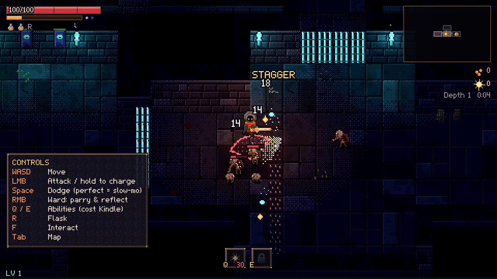

| | |
|---|---|
| 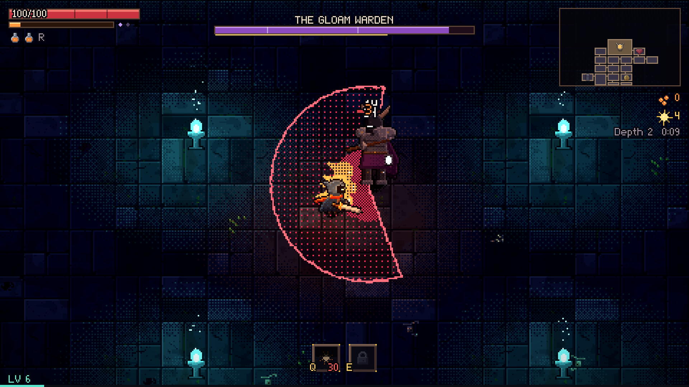 | 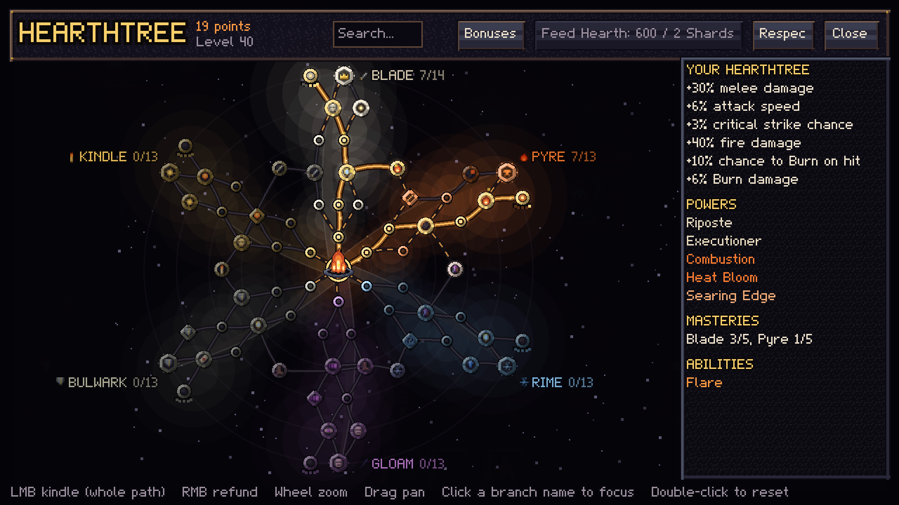 |
| 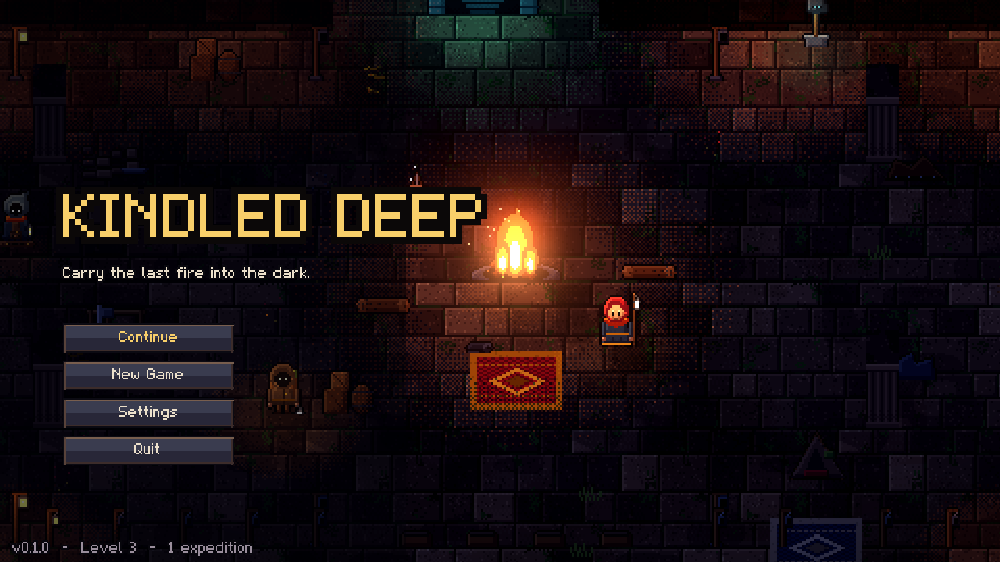 | 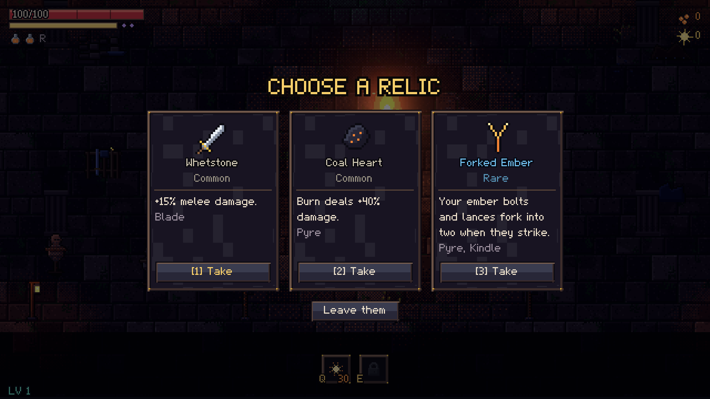 |
| 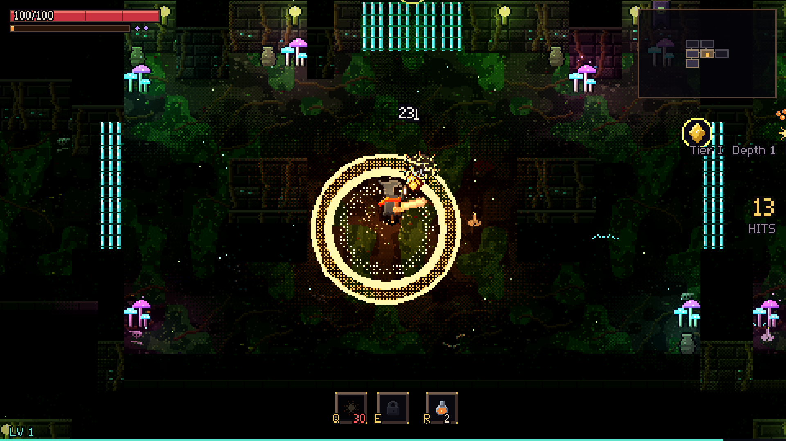 | 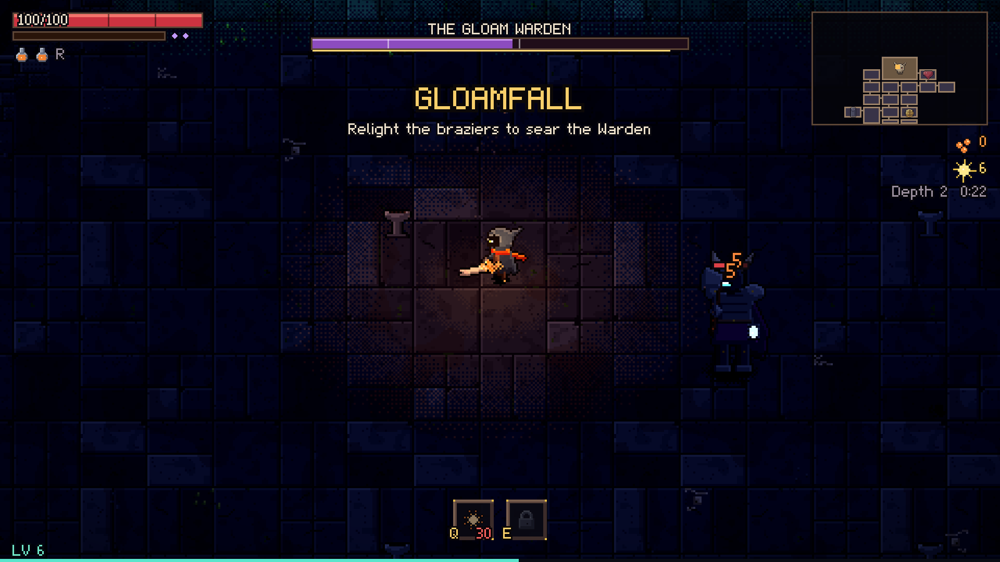 |
| 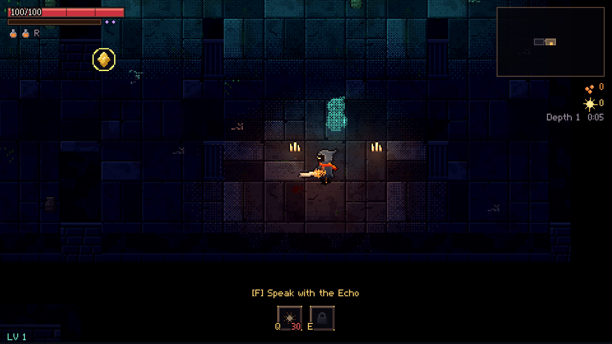 | 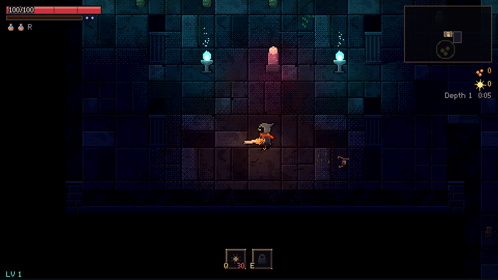 |
| 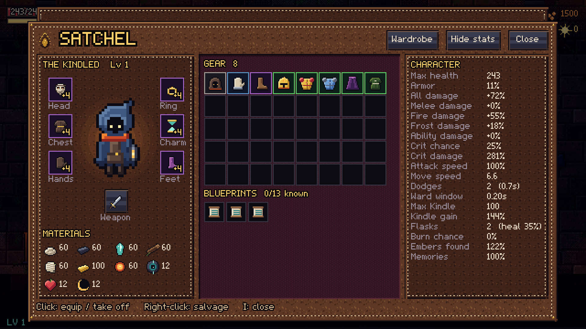 | 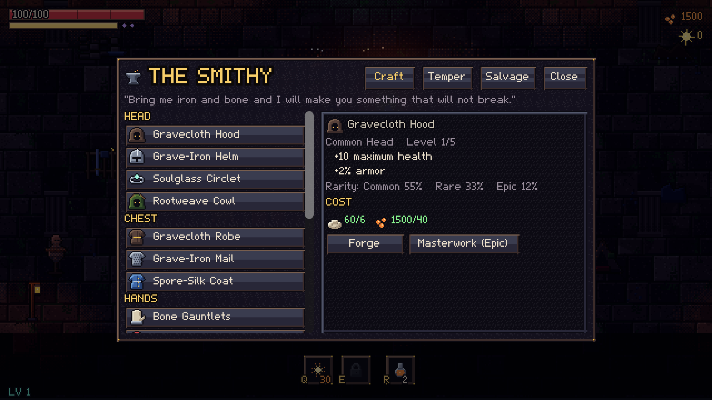 |
| 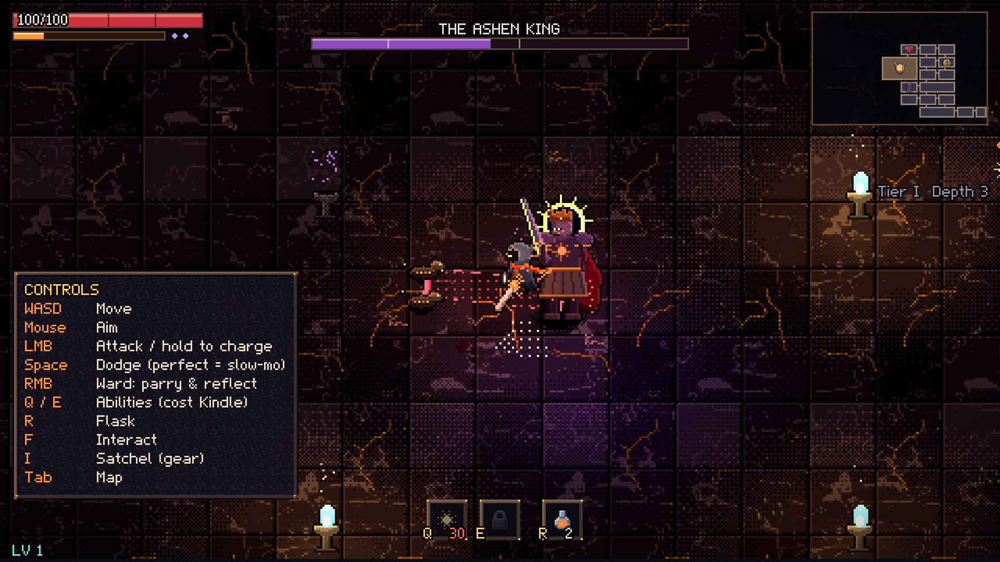 | 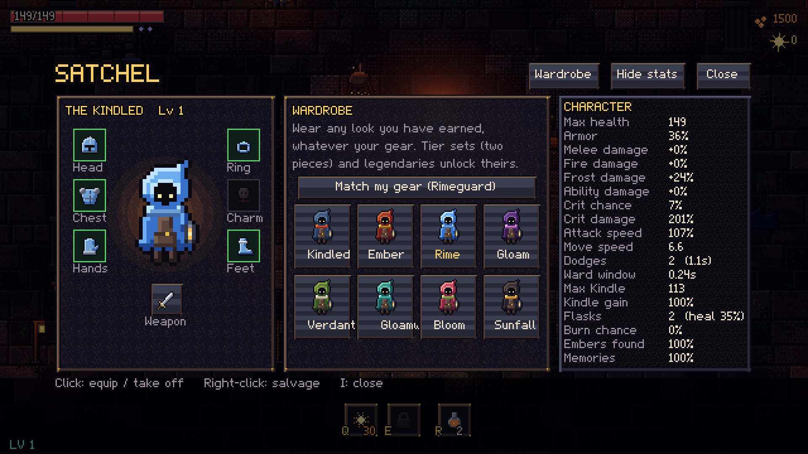 |
| 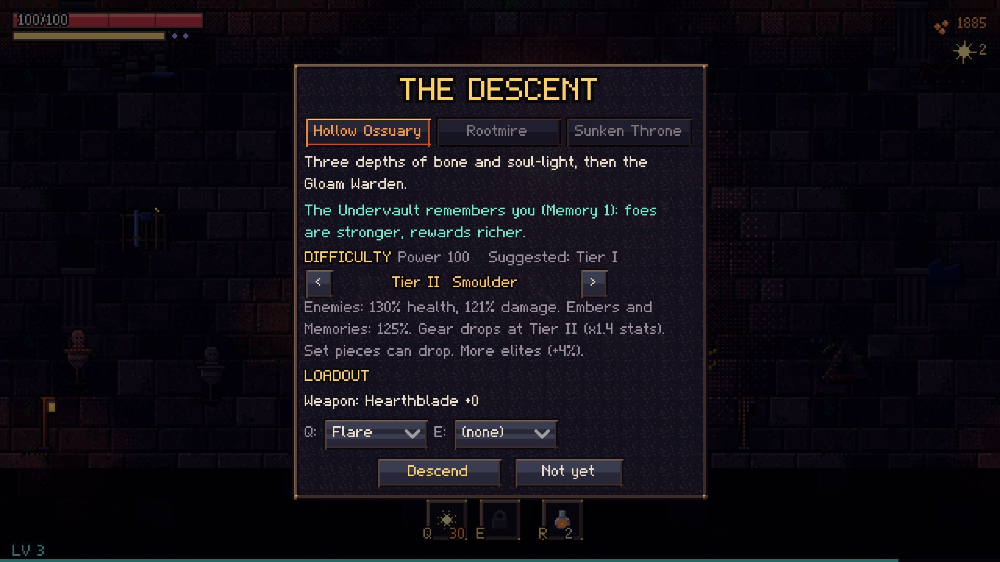 | 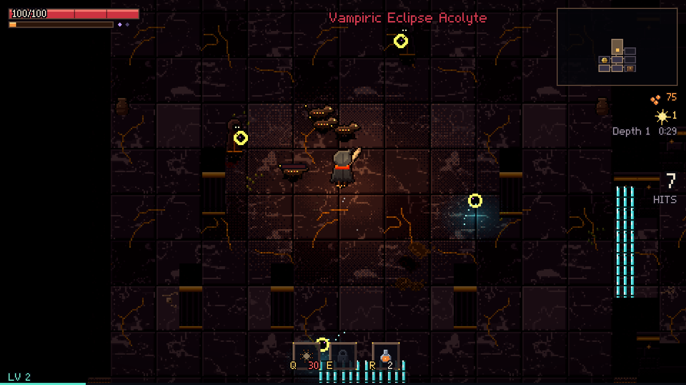 |

## Features

- Skill-based combat: five distinct weapons (blade, hammer, staff, twin daggers,
  glaive) with combos and charged attacks, forged up to +10 with Masterwork and
  Ascended upgrades,
  dodge with perfect-dodge slow motion, Ward (parry and reflect), Kindle-fuelled
  abilities, status effects and elemental reactions.
- Procedural floors with branching routes, reward previews on doors, secret
  rooms, merchants, shrines of pacts, traps and extraction points.
- Twenty-two creatures with roles and readable telegraphs - burrowing
  Gravemoles, shield-binding Lampwights, Spore Mortars, wall-growing
  Bramblewrights, riposting Duelists, beam-sweeping Sunwatchers and more - built
  into fights by role pairings; elites with behaviour-changing affixes (Molten,
  Splitting, Gloom...).
- **Grudges**: the enemy that kills you returns by name, carrying your lost
  Embers - and left alone it grows, learning new traits.
- **Omens**: optional signs read at the Undervault Gate (Lightless, Restless
  Dead, Glass Kindled...) that make a descent harder and pay for it.
- Three regions of three depths: the Hollow Ossuary (the Gloam Warden snuffs the
  arena's light), the Rootmire (burnable brambles; the Hollow Bloom, a rooted
  corpse-flower whose roots you burn to wilt it) and the capstone, the Sunken
  Throne (the Ashen King puts out the sun - stand in the braziers' light).
- Difficulty tiers I-VIII (tougher foes, two-affix elites, richer loot);
  conquering the Sunken Throne opens the next tiers.
- Room events: Ember Wells, Trials of the Undervault, echoes of fallen Kindled,
  Sconce Vaults (light every sconce before one burns out) and lost camps.
- Loot beams by rarity, and the light of what you wear.
- The Hearthtree: a 74-node constellation skill tree with keystones, hybrids and
  ranked masteries, route preview (click any node to kindle the path to it),
  search, a bonuses panel and three saved pages. Levels cap at 60 - about half
  the tree - so builds are choices; experience beyond becomes Renown, and 22
  Feats set long goals (a few grant a point past the cap);
  39 relics that steer builds; an evolving sanctuary whose survivors arrive,
  wander, and talk as the Hearth grows - and ask favours that earn permanent
  gifts - with trophies of fallen bosses, a rack of forged weapons, a lantern lit
  for every two feats and a camp cat.
- Hearthcall: stand still for three seconds and the Hearth pulls you home.
- A bestiary of every creature you have met, with their lore.
- Gear and crafting: six equipment slots, rarities, levels and item tiers,
  four colour-themed tier sets, twenty-four uniques forged from rare blueprints
  (some of them silly - the Squeaky Clogs make enemies trip), materials from
  enemies, chests and bosses, a smithy (craft, masterwork, temper, salvage), a
  peddler, a leather satchel that unbuckles to show the character, bag and
  stats, and a wardrobe to wear any look you have earned.
- Full gamepad support: menus, prompts, rebinding, aim assist.
- Real 3D lighting and shadows rendered as crisp pixel art; all art and audio
  generated by code (`tools/`). Optional creature voices from a licensed pack
  are imported locally (`tools/audio/import_licensed.py`) and never committed.

## Running

Requires Godot 4.7.x (standard build).

```
godot --path .                 # play
godot --path . -- scene=hub    # jump to the sanctuary
godot --path . -- scene=dungeon region=throne tier=4 kit=4 profile=dev.json   # try the capstone geared at Tier IV
```

Controls: WASD move, mouse aim, LMB attack (hold to charge), Space dodge,
RMB Ward, Q/E abilities, R flask, F interact, Tab map, Esc pause, F12 screenshot.
Gamepad is supported for movement, aiming and combat.

## Development

- Tests: `tools/dev/run_tests.sh` (or `godot --headless --path . res://tests/test_runner.tscn`)
- Rebuild art / audio: `godot --headless --path . -s res://tools/art/build_art.gd`,
  `godot --headless --path . -s res://tools/audio/build_audio.gd`
- Autopilot playtest: `godot --headless --path . -- autopilot scene=dungeon seed=7 frames=20000 quit profile=bot.json`

Docs: [Design](docs/DESIGN.md) - [Architecture](docs/ARCHITECTURE.md) - [Status](docs/STATUS.md) - [CLAUDE.md](CLAUDE.md)
